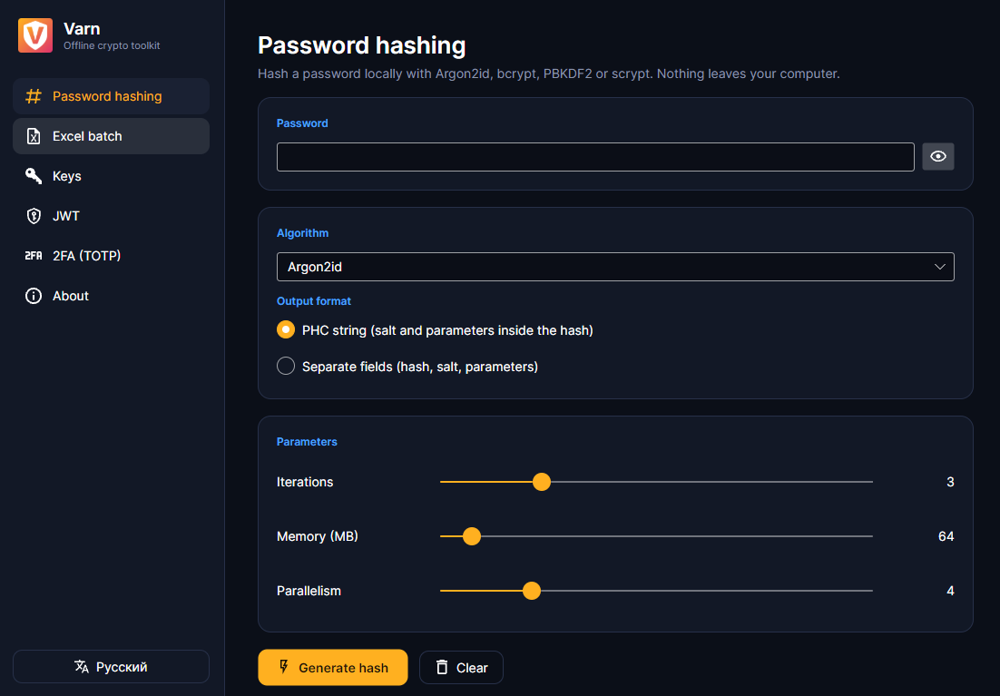
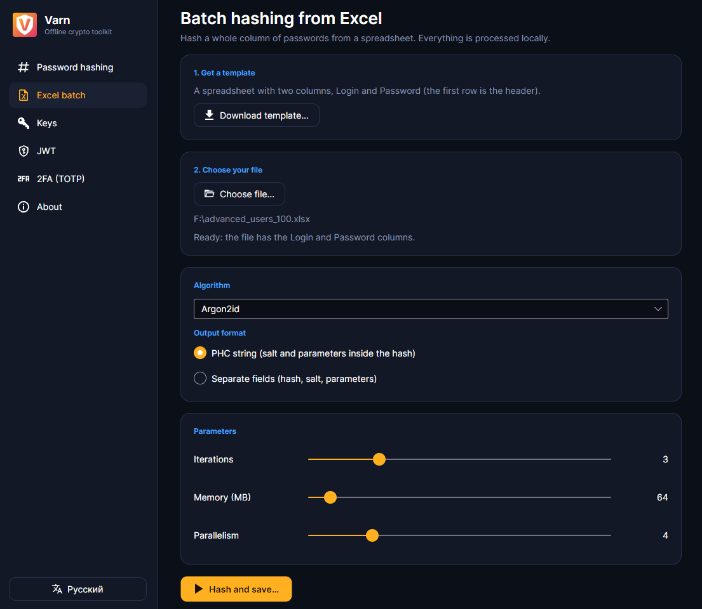
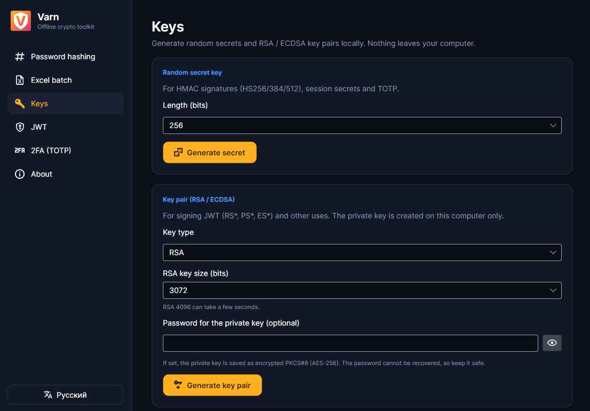
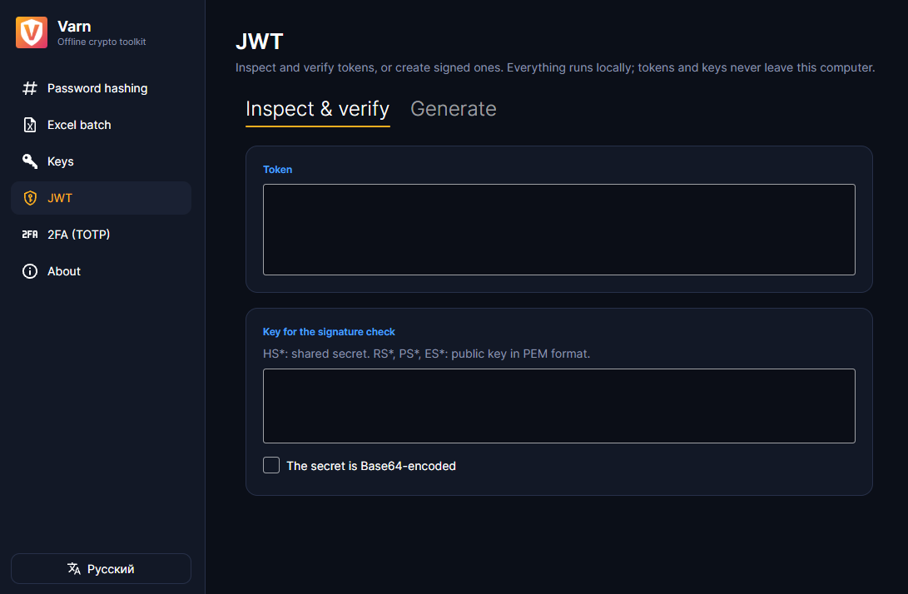
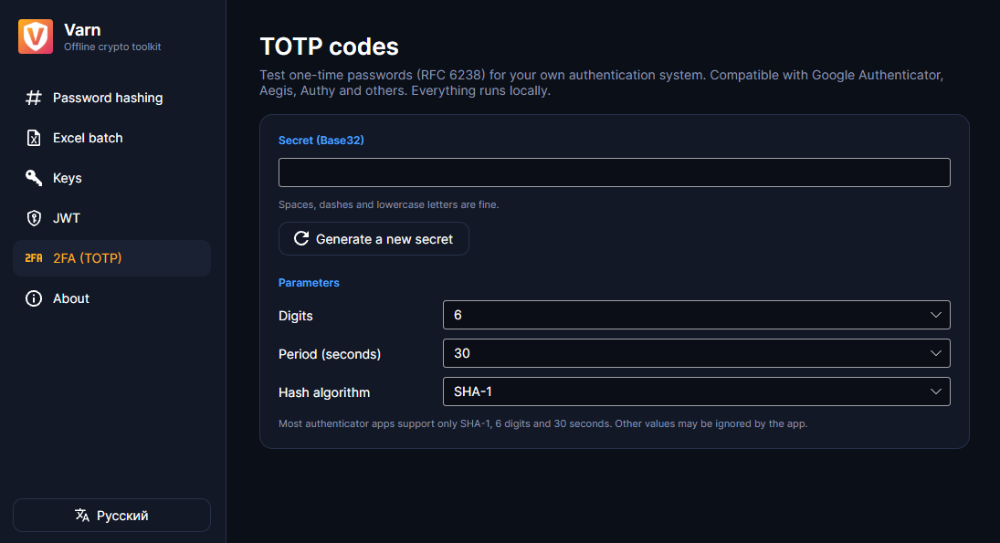

<div align="center">


# Varn

**Офлайн-набор криптографических инструментов для разработчиков.**
Хэширование паролей, ключи, разбор JWT и проверка одноразовых кодов. Всё выполняется на вашем компьютере.

[English](README.md) · [Русский](README.ru.md)

</div>

> Раньше проект назывался **Basalt**.

## Зачем

Многие привычные криптозадачи (хэш тестового пароля, разбор токена, проверка секрета TOTP) обычно решают на сайтах. Вставлять настоящие секреты на сайт плохая привычка. Varn делает то же самое локально и не обращается к сети.

## Возможности

- **Хэширование паролей**: Argon2id, bcrypt, PBKDF2 (SHA-256/512) и scrypt с разумными значениями по умолчанию (Argon2id t=3, 64 МиБ, p=4; PBKDF2 600 000 итераций; bcrypt cost 12; scrypt N=2^16). Вывод в виде строки PHC или отдельных хэша, соли и параметров. Устаревшие SHA-256, MD5 и SHA-1 нужны только для эмуляции старых систем.
- **Пакетное хэширование из Excel**: целый столбец паролей (`Login`, `Password`) на входе, на выходе хэш, соль, алгоритм, параметры и примечания. Параллелизм ограничивается доступной памятью, процесс можно отменить.
- **Ключи**: случайные секреты (128/256/512 бит в Base64, Hex или Base32) и пары ключей RSA (2048/3072/4096) или ECDSA (P-256/384/521). Экспорт в PEM (PKCS#8 и SPKI) или JWK, при желании с приватным ключом, зашифрованным AES-256.
- **JWT**: просмотр и проверка HS256/384/512, RS256/384/512, PS256/384/512 и ES256/384/512, а также создание подписанных токенов. Предупреждает про `alg: none`, ключи для подмены алгоритма и слабые секреты, показывает `iat`, `nbf` и `exp` со статусом.
- **TOTP (RFC 6238)**: живые коды с предыдущим и следующим, SHA-1/256/512, 6–8 цифр, периоды 15/30/60 с, проверка кода с настраиваемым допуском по времени, а также ссылки `otpauth://` с QR-кодами для приложений-аутентификаторов.
- Кроссплатформенный интерфейс на Avalonia, на русском и английском.

## Скриншоты







## Загрузка

Свежую сборку можно скачать на странице [Releases](https://github.com/Eylente/varn/releases). Сборка для Windows самодостаточная и не требует установленного .NET. Сборка для Linux тоже есть, но пока не проверялась.

## Сборка из исходников

Нужен [.NET 10 SDK](https://dotnet.microsoft.com/download).

```bash
git clone https://github.com/Eylente/varn.git
cd varn
dotnet run --project Varn.Desktop
dotnet test
```

## Структура проекта

| Проект | Описание |
|---|---|
| `Varn.Core` | Логика хэширования, ключей, JWT и TOTP. Без зависимостей от интерфейса. |
| `Varn.Desktop` | Десктопное приложение на Avalonia (MVVM). |
| `Varn.Core.Tests` | Тесты xUnit, в том числе на известные эталонные значения (RFC 6238, RFC 7914, PBKDF2-SHA256, токен с jwt.io). |

## Безопасность и ограничения

- Varn работает полностью офлайн. Единственное, что он сохраняет на диск, это язык интерфейса (`settings.json` в профиле пользователя).
- Varn **не проходил независимый аудит**. Это инструмент для разработки и диагностики, не используйте его для создания секретов, которые защищают реальные системы.
- Криптография берётся из известных библиотек (.NET, Konscious.Security.Cryptography для Argon2, BCrypt.Net-Next, BouncyCastle для scrypt, Otp.NET), а не из самописных реализаций.
- Пароли и секреты вводятся как строки .NET, а строки нельзя стереть из памяти. Varn затирает байтовые буферы, которые создаёт сам, и очищает скопированное из буфера обмена через 30 секунд. Это не защита от того, кто может читать память компьютера, а менеджеры буфера обмена (например, история буфера Windows) хранят собственные копии.
- Устаревшие хэши (MD5, SHA-1, обычный SHA-256) небезопасны. bcrypt учитывает только первые 72 байта пароля.

## Идеи на будущее

- Проверка существующего хэша по паролю
- Ключи Ed25519
- Проверенные сборки для Linux и macOS

## Лицензия

MIT. См. [LICENSE.txt](LICENSE.txt). Сторонние компоненты перечислены в [THIRD-PARTY-NOTICES.md](THIRD-PARTY-NOTICES.md).